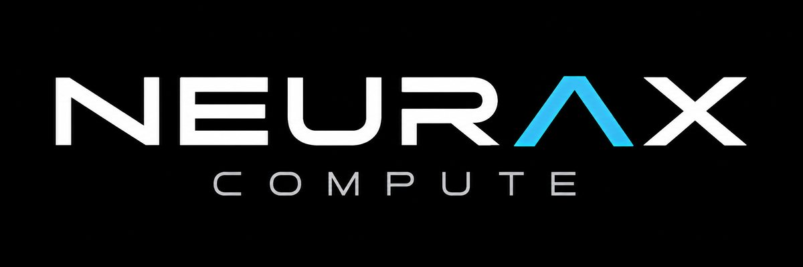

<p align="center"></p>

[English](README.md) · **Italiano**

# NEURAX Compute — sviluppatori

**Calcolo distribuito sovrano e verificabile, via API.**
Prezzi di opzioni, rischio di portafoglio (anche con BTC), matrici, programmi in contenitore,
rendering 3D e risposte istantanee con NEURAX Edge. Si paga in euro, solo il risultato verificato.

| | |
|---|---|
| Documentazione completa | https://neuraxcopute.it/sviluppatori |
| Indirizzo dell'API | `https://api.neuraxcopute.it` |
| Specifica OpenAPI 3.1 | [`openapi.yaml`](openapi.yaml) |
| Chiave API | portale clienti → **Accesso API** → https://clienti.neuraxcopute.it |
| Verifica di un fascicolo | https://neuraxcopute.it/verifica |

## Che cosa trovi qui

- [`openapi.yaml`](openapi.yaml) — la specifica dell'API, per generare un client in qualsiasi linguaggio
- [`python/`](python) — libreria Python ufficiale, senza dipendenze (`from neurax import Client`)
- [`examples/`](examples) — esempi pronti: curl, Python, JavaScript, Excel (Power Query)
- [`docs/`](docs) — guide: [primi passi](docs/it/primi-passi.md), [rischio con BTC e altri titoli](docs/it/rischio.md),
  [fascicolo di prova](docs/it/fascicolo.md), [contenitori e rendering](docs/it/contenitori.md)

## In 30 secondi

```bash
pip install "git+https://github.com/neurax-compute/developers.git#subdirectory=python"
export NEURAX_KEY="nxk_la_tua_chiave"
```

```python
from neurax import Client

nx = Client()
r = nx.run("mc-var@1", {
        "positions": [{"name": "BTC", "value_eur": 100000, "volatility": 0.60},
                      {"name": "Azione XY", "value_eur": 200000, "volatility": 0.25}],
        "correlation": [[1, 0.3], [0.3, 1]],
        "horizon_days": 10, "scenarios": 2000000},
    region="EUROPE")            # eseguito solo su nodi in Europa
print(r["var_99_eur"], r["es_99_eur"])
```

*(i valori di volatilità e correlazione sono un esempio di formato, non dati di mercato)*

## Perché NEURAX è diverso

- **Verificato**: ogni risultato viene controllato prima dell'addebito; un nodo che sbaglia non viene pagato.
- **Sovrano**: per ogni lavoro scegli dove (`region`: Europa o Svizzera) e da chi (`sovereign`: solo partner verificati).
- **Provato**: ogni lavoro ha un fascicolo firmato digitalmente, verificabile da chiunque.
- **In euro**: nessuna criptovaluta, contabilità a partita doppia.

## Community

- **Domande e idee**: scheda *Discussions* di questo repository.
- **Problemi**: apri una *Issue* con il modello "Segnala un problema".
- **Nuove funzioni**: modello "Proponi una funzione".
- **Sicurezza**: non aprire issue pubbliche, scrivi a info@swissgroupnetwork.ch (vedi [SECURITY.md](SECURITY.md)).

## Licenza e proprietà

Il codice di esempio e la libreria client di questo repository sono rilasciati con licenza **MIT** ([LICENSE](LICENSE)):
puoi usarli liberamente nei tuoi programmi.

Il servizio NEURAX Compute, il motore di calcolo, gli algoritmi NEURAX Edge e NEURAX Bounce, il coordinatore
e i nodi **non** fanno parte di questo repository e restano proprietà esclusiva di Swiss Group Network SNC.
NEURAX, NEURAX Compute, NEURAX Edge e NEURAX Bounce sono segni distintivi di Swiss Group Network SNC
e non sono concessi in licenza ([MARCHI.md](TRADEMARKS.md)). L'uso del servizio è regolato dai
[termini per i clienti](https://clienti.neuraxcopute.it/termini.html).

---
Swiss Group Network SNC · Via Crodolo 4b · 6614 Brissago · Svizzera · IDI CHE-231.941.170
