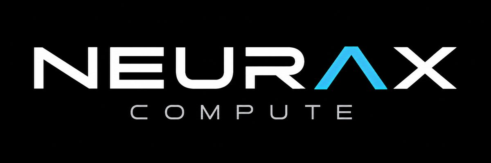

<p align="center"></p>

**English** · [Italiano](README.it.md)

# NEURAX Compute — Developers

**Sovereign and verifiable distributed computing, through an API.**
Option pricing, portfolio risk (including Bitcoin), matrix multiplication, containerised programs,
3D rendering and instant responses with NEURAX Edge. Paid in euro, and only for verified results.

| | |
|---|---|
| Full documentation | https://neuraxcopute.it/sviluppatori |
| API base URL | `https://api.neuraxcopute.it` |
| OpenAPI 3.1 specification | [`openapi.yaml`](openapi.yaml) |
| API key | customer portal → **Accesso API** → https://clienti.neuraxcopute.it |
| Verify an evidence file | https://neuraxcopute.it/verifica |

## What is in this repository

- [`openapi.yaml`](openapi.yaml) — the API specification, to generate a client in any language
- [`python/`](python) — official Python client, no dependencies (`from neurax import Client`)
- [`examples/`](examples) — ready-to-run examples: curl, Python, JavaScript, Excel (Power Query)
- [`docs/`](docs) — guides: [getting started](docs/getting-started.md), [risk with Bitcoin and other assets](docs/risk.md),
  [evidence files](docs/evidence.md), [containers and rendering](docs/containers.md).
  Italian versions in [`docs/it/`](docs/it).

## In 30 seconds

```bash
pip install "git+https://github.com/neurax-compute/developers.git#subdirectory=python"
export NEURAX_KEY="nxk_your_key"
```

```python
from neurax import Client

nx = Client()
r = nx.run("mc-var@1", {
        "positions": [{"name": "BTC", "value_eur": 100000, "volatility": 0.60},
                      {"name": "Stock XY", "value_eur": 200000, "volatility": 0.25}],
        "correlation": [[1, 0.3], [0.3, 1]],
        "horizon_days": 10, "scenarios": 2000000},
    region="EUROPE")            # runs only on nodes located in Europe
print(r["var_99_eur"], r["es_99_eur"])
```

*(volatility and correlation values are a format example, not market data)*

## Why NEURAX is different

- **Verified** — every result is checked before you are charged; a node that returns a wrong result is not paid.
- **Sovereign** — for each job you choose where it runs (`region`: Europe or Switzerland) and by whom (`sovereign`: identity-verified partners only).
- **Provable** — every job comes with a digitally signed evidence file that anyone can verify.
- **In euro** — no cryptocurrency, double-entry accounting.

## Languages

Documentation, examples and the client library are in English, with Italian versions of the guides.
The API itself uses English field names; human-readable error messages (`error.message`) are
currently in Italian — always rely on `error.code`, which is stable.

## Community

- **Questions and ideas**: the *Discussions* tab of this repository.
- **Bugs**: open an *Issue* with the "Bug report" template.
- **New features**: use the "Feature request" template.
- **Security**: do not open public issues, write to info@swissgroupnetwork.ch (see [SECURITY.md](SECURITY.md)).

## License and ownership

The example code and the client library in this repository are released under the **MIT** license ([LICENSE](LICENSE)):
you can use them freely in your own software.

The NEURAX Compute service, its compute engine, the NEURAX Edge and NEURAX Bounce algorithms, the coordinator
and the nodes are **not** part of this repository and remain the exclusive property of Swiss Group Network SNC.
NEURAX, NEURAX Compute, NEURAX Edge and NEURAX Bounce are trademarks of Swiss Group Network SNC and are not
licensed ([TRADEMARKS.md](TRADEMARKS.md)). Use of the service is governed by the
[customer terms](https://clienti.neuraxcopute.it/termini.html).

---
Swiss Group Network SNC · Via Crodolo 4b · 6614 Brissago · Switzerland · UID CHE-231.941.170
